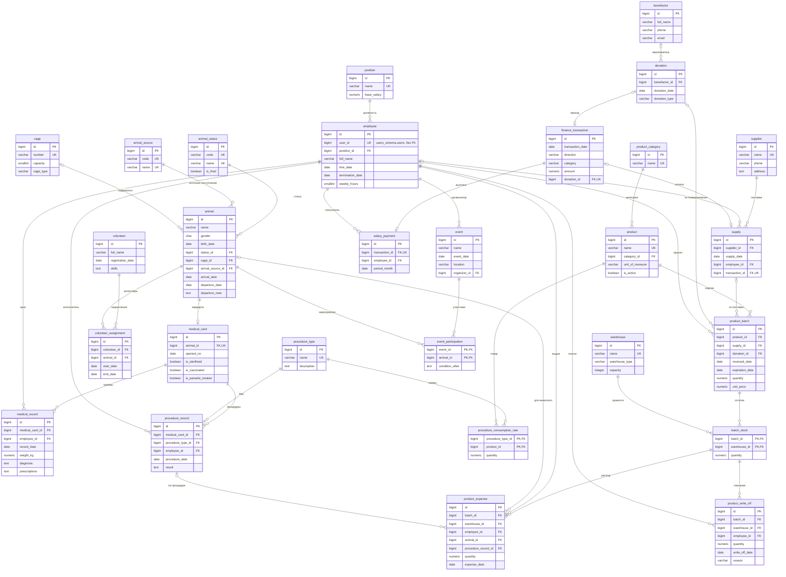

# База данных приюта: схема `shelter_schema`

Схема содержит предметную область приюта: животные и клетки, медицина, склад, люди,
мероприятия и финансы. Учётные записи и роли доступа хранятся отдельно, в схеме
`users_schema` (auth-service).

Схема создаётся миграциями Liquibase (`liquibase/src/main/resources/db/changelog/shelter/`),
Java-классы для работы с ней генерируются jOOQ в пакет `com.shelter.model.generated.shelter`.
Работать со схемой будет `shelter-core-service` (шаги 3–6 плана).

## Соглашения

- Имена таблиц и колонок — `snake_case`, таблицы в единственном числе.
- Первичный ключ — `id BIGINT GENERATED ALWAYS AS IDENTITY`. Составной ключ только у таблиц-связей
  без собственной истории (`batch_stock`, `procedure_consumption_rate`, `event_participation`).
- Типы: деньги — `NUMERIC(12,2)`, количество товара и нормы расхода — `NUMERIC(10,3)`,
  вес — `NUMERIC(5,2)`, бизнес-даты — `DATE`, время создания и изменения записи — `TIMESTAMPTZ`.
- `created_at` / `updated_at` — у справочников, которые редактируются (люди, животные, клетки,
  товары, склады, мероприятия). `updated_at` выставляет приложение (триггеров в схеме нет).
  У журнальных записей (операции, расход, процедуры) — только `created_at`.
- Коды перечислений (`'MONEY'`, `'EXPENSE'`, `'EXPIRED'` и т. п.) — латиницей, названия для людей
  хранятся в справочниках или переводятся в интерфейсе.
- На каждом внешнем ключе есть индекс.
- `ON DELETE`:
  - `CASCADE` — для данных, которые являются частью записи-владельца: медкарта и её записи у животного,
    участие в мероприятии, закрепление волонтёра, остатки партии;
  - `RESTRICT` — для ссылок на людей, товары, справочники и денежные операции:
    история не должна исчезать из-за удаления справочной записи.

## ER-диаграмма

## Таблицы

### Справочники

| Таблица | Назначение | Ключевые поля |
|---|---|---|
| `animal_status` | Статус животного | `code` — код для логики приложения (`IN_SHELTER`, `FOSTER`, `ADOPTED`, `DIED`, `ESCAPED`, `TRANSFERRED`); `name` — название; `is_final` — животное выбыло из приюта |
| `arrival_source` | Откуда животное поступило | `code` (`STREET`, `ABANDONED`, `FROM_OWNER`, `OTHER_SHELTER`, `BORN_IN_SHELTER`, `UNKNOWN`), `name` |
| `procedure_type` | Вид процедуры (вакцинация, стерилизация, осмотр…) | `name` (уникально), `description` |
| `position` | Должность сотрудника — кадровый справочник, не роль доступа | `name`, `base_salary` — месячный оклад при 40 часах в неделю |
| `product_category` | Категория товара (корм, наполнитель, медицина, инвентарь) | `name` |

### Животные и клетки

| Таблица | Назначение | Ключевые поля |
|---|---|---|
| `cage` | Клетка или вольер | `number` (уникально), `capacity` > 0, `cage_type` |
| `animal` | Животное (сейчас — только кошки) | `status_id`; `cage_id` — где содержится (`NULL` — на передержке или выбыло); поступление: `arrival_date`, `arrival_source_id`; выбытие: `departure_date`, итоговый статус и `departure_note`. Проверки: выбытие не раньше поступления, рождение не позже поступления, у выбывшего нет клетки |
| `volunteer_assignment` | Закрепление волонтёра за животным | `volunteer_id`, `animal_id`, `start_date`, `end_date` ≥ `start_date`. Уникальный частичный индекс: не больше одного действующего закрепления на пару волонтёр–животное |

### Медицина

| Таблица | Назначение | Ключевые поля |
|---|---|---|
| `medical_card` | Медицинская карта, одна на животное | `animal_id` (уникально), `opened_on`, текущее состояние: `is_sterilized`, `is_vaccinated`, `is_parasite_treated` |
| `medical_record` | Запись приёма (осмотра) | `medical_card_id`, `employee_id` (врач), `record_date`, `weight_kg` > 0, `diagnosis`, `prescriptions` |
| `procedure_record` | Проведённая процедура | `medical_card_id`, `procedure_type_id`, `employee_id`, `procedure_date`, `result` |
| `procedure_consumption_rate` | Норма расхода товара на одну процедуру | ключ (`procedure_type_id`, `product_id`), `quantity` > 0 |

### Склад

| Таблица | Назначение | Ключевые поля |
|---|---|---|
| `product` | Товар | `name` (уникально), `category_id`, `unit_of_measure`, `is_active` — товар в обороте |
| `warehouse` | Склад (место хранения) | `name` (уникально), `warehouse_type`, `capacity` |
| `supplier` | Поставщик | `name` (уникально), контакты |
| `supply` | Поставка (закупка у поставщика) | `supplier_id`, `supply_date`, `employee_id` (принял), `transaction_id` — оплата в журнале операций |
| `product_batch` | Партия товара | `product_id`; источник — ровно один из `supply_id` и `donation_id`; `received_date`, `expiration_date` > `received_date`; `quantity` — сколько поступило; `unit_price` — только для закупки |
| `batch_stock` | Текущий остаток партии на складе | ключ (`batch_id`, `warehouse_id`), `quantity` ≥ 0 |
| `product_expense` | Расход товара | ссылка на строку остатка (`batch_id`, `warehouse_id`); `employee_id`; `animal_id` (необязательно — общий расход); `procedure_record_id` — расход по процедуре; `quantity` > 0; `expense_date` |
| `product_write_off` | Списание товара | ссылка на строку остатка; `reason` (`EXPIRED`, `DAMAGED`, `LOST`, `OTHER`); `quantity` > 0; `write_off_date`; `employee_id` |

### Люди

| Таблица | Назначение | Ключевые поля |
|---|---|---|
| `employee` | Сотрудник | `user_id` — учётная запись в auth-service (уникально, без внешнего ключа между схемами); `position_id`; `hire_date`, `termination_date` ≥ `hire_date`; `weekly_hours` (0–168, по умолчанию 40); паспорт: 4 + 6 цифр, оба поля или ни одного |
| `volunteer` | Волонтёр | `full_name`, контакты, `registration_date`, `skills`, паспорт с теми же проверками |

### Мероприятия

| Таблица | Назначение | Ключевые поля |
|---|---|---|
| `event` | Мероприятие (выставка, день открытых дверей) | `name`, `event_date`, `location`, `organizer_id` — ответственный сотрудник |
| `event_participation` | Участие животного в мероприятии | ключ (`event_id`, `animal_id`), `condition_after` — состояние после мероприятия |

### Финансы

| Таблица | Назначение | Ключевые поля |
|---|---|---|
| `benefactor` | Благотворитель (человек или организация) | `full_name`, контакты |
| `donation` | Пожертвование | `benefactor_id` (`NULL` — анонимно), `donation_date`, `donation_type` (`MONEY`, `GOODS`). Сумма денежного пожертвования — в `finance_transaction`, товары натурального — в `product_batch` |
| `finance_transaction` | Единый журнал движения денег | `direction` (`INCOME`, `EXPENSE`), `category` (`DONATION`, `SALARY`, `PURCHASE`, `OTHER`), `amount` > 0, `transaction_date`, `donation_id`. Проверки: ссылка на пожертвование есть ровно у категории `DONATION`; пожертвование — всегда приход, зарплата и закупка — всегда расход |
| `salary_payment` | Выплата зарплаты за месяц | `transaction_id` (сумма — в операции), `employee_id`, `period_month` — первое число месяца. Уникальность (`employee_id`, `period_month`) |

Баланс приюта = сумма операций `INCOME` − сумма операций `EXPENSE`.

## Отличия от схемы прототипа

Источник — дамп рабочей базы прототипа (`db_seed.sql`), а не `db_create.sql`: скрипт создания
устарел и не содержит колонок, которые использует приложение (`product.category`, `product.is_active`,
`product_batch.employee_id`, `account.batch_id`, `event.notes`), а количества в дампе уже дробные.

1. **Удалена таблица `source_of_arrival`** («обобщающая сущность» из одного `id` с подтипами `supply`
   и `donation`). Она не несла данных, усложняла вставку (сначала пустая строка-родитель, потом подтип)
   и совпадала по названию с колонкой `cat.source_of_arrival`, означающей совсем другое — откуда
   поступило животное. Вместо неё у партии две ссылки, `supply_id` и `donation_id`, и проверка
   «ровно одна из них заполнена».
2. **Деньги хранятся в одном месте.** В прототипе сумма денежного пожертвования записывалась трижды
   (`donation.amount`, `monetary_donation.amount`, `account.amount`), а баланс собирался из трёх таблиц
   по разным правилам. Из-за этого расходы с типом «Расход», кроме зарплат (например, ремонт клеток),
   в баланс не попадали. Таблицы `account` и `monetary_donation` заменены журналом `finance_transaction`
   с направлением и категорией; баланс считается одной формулой.
3. **Суррогатные ключи вместо составных из бизнес-полей.** В прототипе ключ `procedure_record` —
   (сотрудник, вид, кот, дата), `medical_record` — (сотрудник, карта, дата), `product_expense` —
   (сотрудник, партия, кот, дата): нельзя записать две одинаковые процедуры или два расхода за день.
   Ключ `volunteer_care` (волонтёр, кот) не позволял закрепить волонтёра повторно после окончания
   закрепления, а ключ `salary_payment` (сотрудник, счёт) был бессмысленным. Теперь у всех `id`,
   а нужные ограничения заданы явно: одна зарплата сотруднику за месяц, одно действующее закрепление.
4. **Справочники с числовым ключом.** `position` и `procedure_type` использовали название как
   первичный ключ: переименование должности ломало ссылки. Теперь `id` + уникальное название.
5. **Учёт поступления животного.** В прототипе была только дата выбытия. Добавлены `arrival_date`
   и ссылка на справочник `arrival_source` (вместо CHECK со списком строк в таблице кошек),
   комментарий к выбытию `departure_note`; причина выбытия — итоговый статус (`is_final`).
6. **Выбывшее животное не занимает клетку.** В прототипе `cage_id` был обязательным, поэтому
   выбывшие кошки «числились» в клетках и вместимость приходилось считать с фильтром. Теперь
   `cage_id` необязателен, и проверка запрещает клетку у выбывшего животного.
7. **Убрана проверка `departure_date <= CURRENT_DATE`.** Ограничение CHECK с текущей датой
   проверяется только при записи и может «сломаться» при восстановлении данных. Правило перенесено
   в приложение, в базе осталась проверка «выбытие не раньше поступления».
8. **Списание оставляет след.** В прототипе списание обнуляло остаток без записи. Добавлена таблица
   `product_write_off` с причиной, датой и сотрудником.
9. **Расход привязан к складу.** В прототипе расход уменьшал «первый найденный» остаток партии,
   хотя партия могла лежать на нескольких складах. Теперь расход и списание ссылаются на конкретную
   строку `batch_stock` составным внешним ключом.
10. **Расход связан с процедурой.** Добавлена ссылка `product_expense.procedure_record_id`:
    видно, какие товары израсходованы по нормам на конкретную процедуру.
11. **Норма расхода больше нуля.** В прототипе ограничение ослабили до `>= 0` ради записи
    «Осмотр — шприц — 0 (может не требоваться)». Нулевая норма ничего не означает: если товар
    не нужен, строки нормы нет.
12. **История веса.** Вес был одним полем медкарты и перезаписывался. Теперь вес хранится в каждой
    записи приёма (`medical_record.weight_kg`), текущий вес — из последней записи.
13. **Добавлены недостающие поля:** название поставщика (было только телефон и адрес), название
    склада (был только тип), сотрудник у поставки, анонимные пожертвования (`benefactor_id` необязателен).
14. **Паспорт проверяется по формату:** серия — 4 цифры, номер — 6 цифр, заполнены оба или ни одного.
    В прототипе проверялась только суммарная длина 10 символов, поэтому проходили, например, 3 + 7.
    Телефон допускает формат `+7…` наряду с `8…`.
15. **Учётные записи вынесены в auth-service.** Логин и пароль сотрудника (в прототипе — пароль
    открытым текстом) не переносятся. Сотрудник ссылается на пользователя через `employee.user_id`
    (уникально, без внешнего ключа между схемами). Роли доступа (`ADMIN`, `VET`, `CURATOR`,
    `ADOPTION_MANAGER`, `COORDINATOR`, `VISITOR`) не связаны с должностями: должность определяет
    оклад, роль — права в системе.
16. **Часы работы.** `work_hours` переименовано в `weekly_hours` с проверкой 0–168 и значением
    по умолчанию 40: в прототипе это поле использовалось как «часов в неделю» при расчёте зарплаты
    (оклад × часы / 40), но по умолчанию было 0, и новый сотрудник получал нулевую зарплату.
17. **Справочники дополнены кодами.** У статусов и источников поступления есть `code` для логики
    приложения: прототип определял пристроенных кошек поиском подстроки «пристро» в названии статуса.
    Дубль вида процедуры «базовый осмотр» объединён с «Осмотр».
18. **Триггеры и представления не переносятся.** Их логика будет реализована в `shelter-core-service`
    (см. следующий раздел): правила остаются в одном месте и покрываются тестами.

## Бизнес-правила для реализации

Все правила реализуются в `shelter-core-service`. Источник: `T` — триггер или представление
прототипа, `S` — C#-сервис прототипа, `Н` — новое правило, следующее из изменений схемы.

### Шаг 3 — животные, клетки, статусы

| Правило | Источник |
|---|---|
| При поступлении животного в статусе «в приюте» клетка обязательна | S: CatService |
| В клетке не больше `capacity` животных, которые сейчас в приюте (при поступлении и переводе) | S: CatService, CageService |
| Выбытие: дата не позже сегодняшней и не раньше поступления; статус меняется на итоговый (`is_final`); клетка освобождается | Н (замена CHECK прототипа) |
| Животное с итоговым статусом должно иметь дату выбытия, и наоборот | Н |
| При выбытии животное удаляется из мероприятий, которые пройдут позже даты выбытия | T: `trg_cat_departure` |
| При выбытии действующие закрепления волонтёров закрываются датой выбытия | Н |
| Сводка по клеткам: занято / свободно мест | S: CageService |

### Шаг 4 — медицина

| Правило | Источник |
|---|---|
| У животного не больше одной медкарты; карта открывается при поступлении | S: MedicalCardService |
| Вид процедуры: название уникально; нормы расхода только с количеством больше нуля; изменение норм заменяет список целиком | S: ProcedureService |
| При проведении процедуры товары списываются со склада по нормам расхода (записи `product_expense` со ссылкой на процедуру) с проверкой остатков | Н |
| Процедуры «Стерилизация»/«Кастрация», «Вакцинация», «Дегельминтизация»/«Обработка от блох» обновляют флаги медкарты | Н |
| Текущий вес — из последней записи приёма с указанным весом | Н |

### Шаг 5 — склад

| Правило | Источник |
|---|---|
| Расход не больше остатка партии на выбранном складе; полностью израсходованную партию использовать нельзя | T: `trg_expense_remains_check` |
| Расход уменьшает остаток, удаление записи расхода возвращает количество на склад | S: WarehouseService |
| Партию с истёкшим сроком годности нельзя использовать — только списать | T: `trg_check_batch_expiry`, S: WarehouseService |
| Списание уменьшает остаток и сохраняет причину | Н (в прототипе остаток обнулялся без записи) |
| Партию, по которой уже был расход, удалить нельзя; при удалении партии удаляется и её оплата | S: WarehouseService |
| Закупка: стоимость партий не больше текущего баланса; создаётся операция `EXPENSE`/`PURCHASE` | S: WarehouseService |
| Товар с историей не удаляется, а выводится из оборота (`is_active = false`) | S: WarehouseService |
| Отчёт «истекающие партии»: срок годности в ближайшие 30 дней и есть остаток, ближайшие первыми | T: `v_expiring_batches` |
| Отчёт «остатки по товарам»: сумма по партиям, количество партий, ближайший срок, признак «скоро истекает» | T: `v_warehouse_stock` |

### Шаг 6 — волонтёры, мероприятия, финансы

| Правило | Источник |
|---|---|
| Волонтёр не может быть дважды одновременно закреплён за одним животным | S: VolunteerService |
| Добавить животное в мероприятие можно только в день его проведения | T: `trg_cat_event_date`, S: EventService |
| Нельзя добавить животное, выбывшее раньше даты мероприятия, и нельзя добавить его дважды | T: `trg_cat_event_date`, S: EventService |
| При переносе мероприятия из него удаляются животные, выбывшие раньше новой даты | T: `trg_event_date_change` |
| Эффективность мероприятия: участники и доля пристроенных впоследствии (по коду статуса `ADOPTED`) | T: `v_event_adoption_rate` |
| Денежное пожертвование: сумма больше нуля, создаётся операция `INCOME`/`DONATION` | S: FinanceService |
| Натуральное пожертвование: хотя бы один товар с количеством больше нуля; создаются партии и остатки | S: FinanceService |
| Пожертвование можно указать по существующему благотворителю или по имени (создаётся новый) | S: FinanceService |
| Удаление пожертвования: натуральное — нельзя, если товары уже расходовались; денежное — нельзя, если баланс станет отрицательным | S: FinanceService |
| Зарплата за месяц начисляется работающим сотрудникам (без даты увольнения): оклад должности × `weekly_hours` / 40; один раз за месяц; дата выплаты — последний день месяца; есть предварительный расчёт | S: FinanceService |
| Баланс = приход − расход по журналу операций | T: `v_finance_balance`, S: FinanceService |
| Сотрудник: должность должна существовать; `user_id` уникален и указывает на пользователя auth-service | S: EmployeeService, Н |

## Миграции и данные

| changeset | Содержание | Загружается |
|---|---|---|
| `shelter-V1` | Справочники: `animal_status`, `arrival_source`, `procedure_type`, `position`, `product_category` | всегда |
| `shelter-V2` | Люди: `employee`, `volunteer` | всегда |
| `shelter-V3` | Животные и клетки: `cage`, `animal`, `volunteer_assignment` | всегда |
| `shelter-V4` | Финансы: `benefactor`, `donation`, `finance_transaction`, `salary_payment` | всегда |
| `shelter-V5` | Склад: `product`, `warehouse`, `supplier`, `supply`, `product_batch`, `batch_stock`, `product_expense`, `product_write_off` | всегда |
| `shelter-V6` | Медицина: `medical_card`, `medical_record`, `procedure_record`, `procedure_consumption_rate`, связь расхода с процедурой | всегда |
| `shelter-V7` | Мероприятия: `event`, `event_participation` | всегда |
| `shelter-V8` | Начальные значения справочников | всегда |
| `shelter-V9-demo` | Демонстрационные данные | только с контекстом `demo` |

Порядок changeset определяется зависимостями: финансы создаются раньше склада, потому что поставка
ссылается на оплату, а партия — на пожертвование; склад — раньше медицины из-за норм расхода.

Контексты задаются переменной `LIQUIBASE_CONTEXTS`. По умолчанию — `default` (схема и справочники);
в `docker-compose.yml` для контейнера `migrations` — `default,demo`. Чтобы не загружать
демонстрационные данные, укажите в `.env` `LIQUIBASE_CONTEXTS=default`. При ручном запуске
из Maven: `mvn -pl liquibase liquibase:update -Dliquibase.contexts=default,demo`.

Демонстрационные данные: 13 кошек во всех статусах, 8 клеток, 7 сотрудников (один уволен),
5 волонтёров, медкарты с приёмами и процедурами, 12 товаров на трёх складах, партии из поставок
и натурального пожертвования (в том числе просроченная и с истекающим сроком), расход по нормам,
списания, два мероприятия, пожертвования (в том числе анонимное) и зарплата за прошлый месяц.
Все люди и организации вымышленные. Даты считаются от дня применения миграции.
